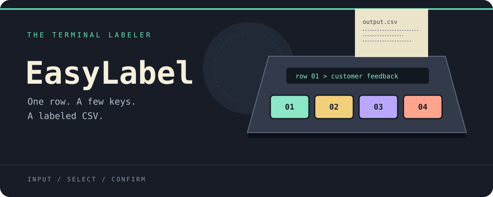
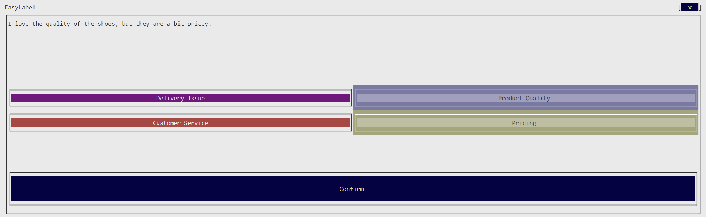

# EasyLabel

Label text in a CSV without leaving your terminal. EasyLabel shows one row at a time and gives each label a color-coded button that stays in the same place. I borrowed the idea from the cash register I used at work.

[Try the sample](#try-the-sample) · [Use your own CSV](#use-your-own-csv)

[](https://github.com/Pop101/EasyLabel/issues)



## Try the sample

Use Python 3.12 or later, [Poetry](https://python-poetry.org/), and an interactive terminal.

```sh
git clone https://github.com/Pop101/EasyLabel.git
cd EasyLabel
poetry install --no-root
poetry run python easy_label.py
```

The bundled `data.csv` contains example customer feedback. Pick one or more labels and select **Confirm** to write that row to `output.csv` and move on. With the sample configuration, chosen labels are written as `True` and the others as `False`. The input CSV stays unchanged.



## Use your own CSV

Open `config.yml`. Under **Data**, set **Path** to your CSV, **Text Column** to the header you want to read, and **Label Columns** to the labels you want as buttons. Under **Output**, set **Path** to a new file.

Use a fresh output path. This version does not reliably resume a run from an existing output CSV.
